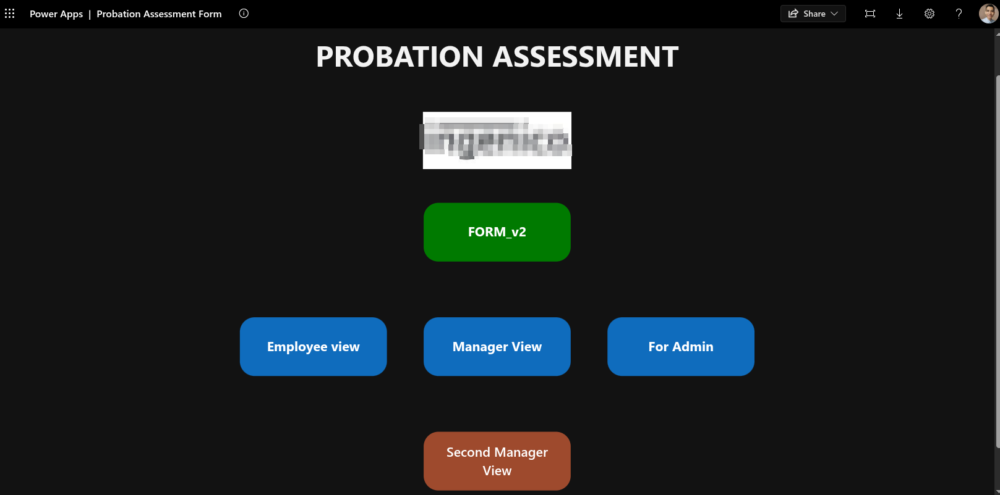

# Probation Assessment Form System (PowerApps & Power Automate)

A comprehensive role-based digital **Probation Assessment System** built with **Microsoft PowerApps**, **Microsoft Lists**, and **Power Automate** to streamline, secure, and standardize employee probation evaluations across HR, employees, managers, and administrators.<!--  -->

---

## 🔄 End-to-End Workflow & Business Process

The application follows an automated, multi-stage lifecycle driven by **Power Automate** flows and **PowerApps** custom views:

```
┌─────────────────┐       ┌────────────────────────┐       ┌────────────────────────┐
│  1. HR Launch   │ ───►  │  2. HR Form Submission │ ───►  │  3. Manager Review &   │
│  (PowerApp)     │       │  (Microsoft List Form) │       │     Acknowledgement    │
└─────────────────┘       └────────────────────────┘       └────────────────────────┘
                                                                       │
                                                                       ▼
┌─────────────────┐       ┌────────────────────────┐       ┌────────────────────────┐
│ 5. Notification │ ◄───  │ 4. Employee Review &   │ ◄───  │ Power Automate Flow    │
│ to HR & Manager │       │    Acknowledgement     │       │ Triggers Employee Alert│
└─────────────────┘       └────────────────────────┘       └────────────────────────┘
```
```

```

### Detailed Workflow Steps:

1. **Step 1 — HR Submission Launch**: HR opens the main PowerApp dashboard and clicks the **FORM_v2** button.
2. **Step 2 — Microsoft Lists Form**: The button redirects HR to the official **Microsoft List / SharePoint Form** ("Probation Form submission") where HR populates key fields (*Employee Name, Probation Due Date, Date Hired, Manager, Country, Status*). The initial status defaults to `Pending Manager action`.
3. **Step 3 — Manager Notification**: Upon form submission, a **Power Automate** cloud flow triggers and sends an automated notification alert to the designated Manager.
4. **Step 4 — Manager Assessment & Approval**: 
   * The Manager accesses the PowerApp via the **Manager View** button to complete and acknowledge the probation assessment.
   * Upon Manager approval, **Power Automate** triggers an email/Teams alert notifying the Employee that their assessment is ready for review.
5. **Step 5 — Employee Acknowledgement**: 
   * The Employee accesses the assessment using the **Employee View** button on the PowerApp dashboard.
   * Once the Employee acknowledges the assessment, **Power Automate** sends a final completion notification to both **HR** and the **Manager** to close the process loop.

---

## 📌 Dashboard View Roles

* **`FORM_v2` (HR Green Button)**: Direct link to the Microsoft List Form to initiate new assessments.
* **`Manager View`**: Interface for direct managers to evaluate performance, provide feedback, and acknowledge probation results.
* **`Employee View`**: Interface for employees to read, review, and formally acknowledge their completed probation assessment.
* **`Second Manager View`**: For escalation, secondary approvals, or upper-management sign-offs where required.
* **`For Admin`**: Administrative portal for managing system settings, permissions, and record status configurations.

---

## 🛠️ Tech Stack & Components

* **Frontend / UI**: Microsoft PowerApps (Canvas App)
* **Form Engine & Backend**: Microsoft Lists / SharePoint Online
* **Workflow Automation**: Microsoft Power Automate (Cloud Flows)
* **Authentication & Identity**: Office 365 / Azure Active Directory

---

## 📊 Data Fields & Schema (Microsoft Lists)

| Field Name | Type | Description |
| :--- | :--- | :--- |
| `Name` | Person or Group | The employee undergoing probation assessment |
| `ProbationDueDate` | Date & Time | Target probation completion date (*Required*) |
| `DateHired` | Date & Time | Employee start date |
| `Manager` | Person or Group | Line Manager responsible for conducting the assessment |
| `Country` | Choice / Single Line | Location/Office region of the employee |
| `Status` | Choice | Workflow state (`Pending Manager action`, `Pending Employee action`, `Completed`) |

---

## 🚀 Deployment Instructions

### Prerequisites
* Microsoft 365 license with access to **PowerApps**, **Power Automate**, and **Microsoft Lists / SharePoint**.
* Appropriate permissions to create lists and import PowerApps.

### Setup Guide
1. **Create Microsoft List**:
   * Set up a list titled `Probation Form submission` with the fields defined in the schema above.
2. **Import Power Automate Flows**:
   * Import the workflow package from `/flows`.
   * Update connection references for Outlook/Teams and SharePoint List connectors.
3. **Import PowerApp Canvas App**:
   * Import the `.msapp` package from `/app` into your PowerApps environment.
   * Re-bind the list data source and verify the `FORM_v2` URL redirect parameter.
4. **Publish & Share**:
   * Publish the PowerApp and distribute app permissions to HR, Managers, and Employees.

---

## 📂 Repository Structure

```
├── app/
│   └── ProbationAssessmentForm.msapp   # PowerApps Canvas App source file
├── flows/
│   ├── ManagerNotificationFlow.zip     # Power Automate: Manager Alert Flow
│   └── EmployeeAckFlow.zip            # Power Automate: Employee Alert & Final HR Notice Flow
├── schema/
│   └── ListSchema.json                 # Microsoft List column definitions
└── README.md                           # Documentation
```

## 📄 License

Distributed under the MIT License. See `LICENSE` for details.